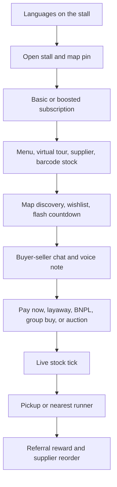

# Street market API

NestJS scaffold for a South African street-market marketplace. State is in memory. Payments, BNPL, and voice files are sandbox records, not live charges or stored audio.

The game in the repo root is separate. This app lives in `marketplace/`.

## Run the flow

```bash
cd marketplace
npm install
npm run flow
```

That boots the modules, walks one buyer journey, and prints every stage. The process exits with an error if a stage is skipped or a handoff breaks.

## Run the API

```bash
cd marketplace
npm install
npm start
```

Then:

- `GET http://localhost:3000/api/flow` — the stage list
- `POST http://localhost:3000/api/flow/walkthrough` — the same journey as JSON
- `GET http://localhost:3000/api/languages` — the twelve official languages
- `GET http://localhost:3000/api/map?lat=-26.204&lng=28.03&lang=af&speaks=zu`
- `GET http://localhost:3000/api/runners`

`PORT` overrides `3000`.

## End-to-end flow



| Phase | What happens | Module |
| --- | --- | --- |
| Setup | Stall profile in the seller's languages. Free basic stall (3 photos) or paid boost (12 photos, map lift). Menu items carry prep minutes. Tour scenes. Supplier link. Barcode scan sets stock. Referral code is issued, and a code books R25 for the referrer. | `sellers`, `i18n`, `catalog` |
| Discovery | Map ranks stalls by distance, with a 3 km visibility lift for boosted stalls. Cards show live available stock. Wishlist, flash sale countdown, group pool, and auction hold. | `discovery` |
| Conversation | One thread per buyer and stall. Text plus voice-note metadata. Ticks move sent → delivered → read. | `chat` |
| Transaction | Pay now takes the flash price and decrements stock. Layaway reserves units until the last installment. BNPL asks a sandbox partner (Payflex, PayJustNow, Mobicred) before the same stock tick. Group buy holds units as people join, then settles. Auction holds one unit, takes bids, and sells to the high bidder. | `checkout` |
| Delivery | Pickup stays at the stall. A runner order goes to the nearest free courier. ETA is prep time plus travel. Status runs assigned → at stall → picked up → delivered. | `delivery` |
| Post-sale | Referral credit is already on the referrer's book. If available stock is at or under the reorder point, a supplier draft is written. | `flow` + `sellers` |

`MarketFlowService.walkthrough()` in `src/flow/market-flow.service.ts` is the wiring. It runs that table in order against the real services.

## Layout

```
src/i18n        languages and fallback copy
src/sellers     stalls, tiers, menu, tour, suppliers, referrals
src/catalog     SKUs, barcode scans, stock ticks
src/discovery   map feed, wishlist, flash, group, auction
src/chat        threads, voice notes, read ticks
src/checkout    orders, layaway, sandbox BNPL
src/delivery    runners and job status
src/flow        stage list and the walkthrough
```

Copy the seller supplies is stored per language tag. English is the fallback. The twelve official languages are built in: English, Afrikaans, isiNdebele, isiXhosa, isiZulu, Sepedi, Sesotho, Setswana, siSwati, Tshivenda, Xitsonga, and South African Sign Language. Other tags such as `hi` or `pt` can be stored as well.
